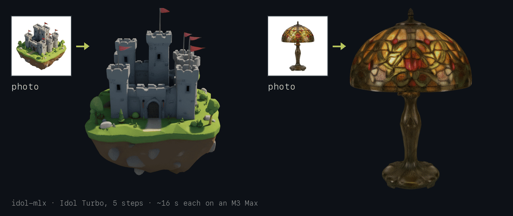
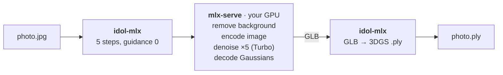

<h1 align="center">idol-mlx</h1>

<p align="center">
  <b>One photo in, a 3D Gaussian splat out, in about 15 seconds on your Mac.</b><br>
  Idol + Idol Turbo, running locally on Apple Silicon.
</p>

<p align="center">
  
  <a href="https://huggingface.co/speridlabs/idol"></a>
  
</p>

<p align="center">
  
</p>

```bash
uvx idol-mlx castle.jpg --view
```

That's it. You get `castle.ply`, a standard 3D Gaussian splat with up to a million Gaussians, including the sides the photo never showed. `--view` opens it in your browser.

## Why

[Idol](https://huggingface.co/speridlabs/idol) by Speri Labs is one of the most popular open image-to-3D models, but at its default 50 steps it takes **about 3 minutes per object on a MacBook**, even with MLX. [Idol Turbo](https://huggingface.co/speridlabs/idol-turbo) gets close to the same result in 5 steps, but it ships as a PyTorch adapter, and PyTorch on a Mac is slow.

`idol-mlx` brings Turbo to the Mac:

|                         | Steps         | M3 Max   |
| ----------------------- | ------------- | -------- |
| Idol (base)             | 50 + guidance | 191 s    |
| **Idol Turbo, idol-mlx** | **5**         | **15 s** |

Everything runs on your machine. There's no account and no upload, and you don't need access to any gated models.

## Install

You need an Apple Silicon Mac with macOS 26.2 or later, and [uv](https://docs.astral.sh/uv/).

```bash
uvx idol-mlx photo.jpg        # run without installing
uv tool install idol-mlx      # or install the `idol-mlx` command
```

The first run installs [mlx-serve](https://github.com/ddalcu/mlx-serve) through Homebrew if you don't have it (it asks first). It then downloads the model and builds the Turbo pack, which takes about a minute and 4.6 GB of downloads, once. To do all of that up front, run `idol-mlx setup`.

## Usage

```bash
idol-mlx photo.jpg                     # → photo.ply
idol-mlx photo.jpg --view              # also open it in the browser
idol-mlx shots/ -o splats/             # every image in a folder
idol-mlx photo.jpg --mode real         # framing tuned for photographs
idol-mlx photo.jpg --format glb        # GLB instead of PLY
idol-mlx photo.jpg --seed 7            # a different take on the same image
idol-mlx photo.jpg --keep-server       # leave the model loaded for the next run
idol-mlx view splats/                  # open .ply files you already have
```

### Turntables

Get a spinning animation of the result, ready to post:

```bash
idol-mlx photo.jpg --turntable         # → photo.ply + photo.gif
idol-mlx photo.jpg --turntable mp4     # MP4 instead (needs ffmpeg)
idol-mlx turntable photo.ply           # from a splat you already have
```

Turntables are rendered in a headless browser, so they need Google Chrome (or Chromium, Brave or Edge). A 72-frame, 640 px GIF takes about 20 s and is 3–5 MB with ffmpeg installed, larger without it.

### Presets

| Flag             | Steps         | Gaussians | M3 Max   | Use it for                              |
| ---------------- | ------------- | --------- | -------- | --------------------------------------- |
| `--fast`         | 4             | 65,536    | 12 s     | Quick previews                          |
| _(default)_      | 5             | 262,144   | 16 s     | Most things                             |
| `--quality high` | 8             | 262,144   | 23 s     | Closest to the original's detail        |
| `--original`     | 50 + guidance | 262,144   | 191 s    | The base model, as the reference        |

Times are per image with the model already loaded. The first image in a run also takes about 3 s to start mlx-serve and load the model.

### Input tips

- **One object, plainly visible.** The background is removed for you.
- Use `--mode real` for photos and the default `--mode synthetic` for renders and generated images. It changes how tightly the object is cropped.
- Objects cut off at the edge of the frame still work, but the hidden part is a guess.

## From Python

```python
from idol_mlx import Idol

with Idol() as idol:                                # starts or reuses the local server
    splat = idol.generate("photo.jpg", steps=5)     # ~16 s
    splat.save("photo.ply")

    for path in ["mug.jpg", "lamp.jpg"]:            # the model stays loaded between calls
        idol.generate(path, seed=7).save(path.replace(".jpg", ".ply"))
```

`generate` also takes `guidance`, `gaussians`, `mode` and an `on_progress` callback that receives each stage.

## How it works



- **mlx-serve does the model work.** It's a native MLX server that already runs Idol on Apple Silicon.
- **idol-mlx adds Turbo.** Turbo is a small adapter (a LoRA) that teaches Idol to finish in 5 steps instead of 50. mlx-serve can't load adapters, so the Turbo pack has the adapter merged into Idol's weights ahead of time: `W' = W + 4·B·A` for each of its 112 layers. To mlx-serve it looks like plain Idol.
- **It also converts the output.** mlx-serve returns a GLB using `KHR_gaussian_splatting`, and idol-mlx rewrites it as a standard 3DGS `.ply`, which works in SuperSplat, Spark, gsplat and the Hugging Face file viewer.

Where the 15 seconds go, measured on an M3 Max:

```
image prep  ▇▇ 1.4 s
denoise ×5  ▇▇▇▇▇▇▇▇▇▇▇▇▇▇▇▇▇▇▇▇▇▇▇▇▇ 12.5 s
octree      ▏ 0.4 s
gaussians   ▇▇▇ 1.6 s
```

## Quality

Turbo trades a little fine detail for a 12× speedup. Outputs are close to the 50-step base model, though a bit softer, and colours can run warm at 4 steps. If a result looks off, try `--quality high` or a different `--seed`. `--original` is always there as the reference.

This build uses Turbo's high-noise ("slow") adapter for every step. The full recipe switches to a second adapter for the last step, which needs adapter support in mlx-serve. Turbo's authors list slow-only as the safe default.

## FAQ

<details>
<summary><b>Does it work on Intel Macs, Linux or Windows?</b></summary>

Not yet. idol-mlx is built on MLX, which is Apple Silicon only. On NVIDIA GPUs, use [Idol's own SDK](https://github.com/speridlabs/idol-sdk) with [Idol Turbo](https://huggingface.co/speridlabs/idol-turbo). An NVIDIA GPU is also much faster.
</details>

<details>
<summary><b>How much memory does it need?</b></summary>

About 4 GB of unified memory while it runs, plus about 3.5 GB of disk for the two model packs.
</details>

<details>
<summary><b>Why not quantize it further to go faster?</b></summary>

On M1–M4 the GPU, not memory, is the bottleneck, and MLX converts 8-bit weights back to 16-bit before multiplying. Smaller weights save memory but not time. The speedup comes from running fewer steps.
</details>

<details>
<summary><b>Where do the files go?</b></summary>

Models live in `~/.mlx-serve/models`: the base pack in `Idol-MLX-Serve-8bit`, and the Turbo pack in `Idol-Turbo`, which links to the base pack's files and adds only the merged denoiser. The full-precision denoiser and the adapter used to build it stay in your Hugging Face cache. mlx-serve's log is `~/.mlx-serve/idol-mlx-server.log`.

`idol-mlx uninstall` removes the Turbo pack, and `idol-mlx uninstall --all` also removes the base pack.
</details>

## Development

```bash
git clone https://github.com/cfahlgren1/idol-mlx && cd idol-mlx
uv sync
uv run pytest                              # fast tests, on a real 32k-Gaussian fixture
IDOL_MLX_E2E=1 uv run pytest tests/test_e2e.py   # the real model, ~20 s once set up
```

The end-to-end tests check that idol-mlx's quantizer reproduces the published 8-bit pack exactly, then run a real generation.

### Releasing

Releases publish from GitHub Actions through PyPI Trusted Publishing, so there's no API token to manage:

```bash
uv version --bump patch            # or minor / major
git commit -am "release v$(uv version --short)"
git tag "v$(uv version --short)" && git push --follow-tags
```

The [release workflow](.github/workflows/release.yml) checks the tag matches the version, runs lint and tests, publishes to PyPI and creates the GitHub release.

## Credits

idol-mlx is an unofficial community project. It is not affiliated with Speri Labs.

- **[Idol](https://huggingface.co/speridlabs/idol)** by [Speri Labs](https://speridlabs.com), Apache-2.0
- **[Idol Turbo](https://huggingface.co/speridlabs/idol-turbo)** adapter by [AK](https://huggingface.co/akhaliq), distilled with the [Glance](https://arxiv.org/abs/2512.02899) phase-LoRA method
- **[mlx-serve](https://github.com/ddalcu/mlx-serve)** and the [8-bit MLX pack](https://huggingface.co/ddalcu/Idol-MLX-Serve-8bit) by ddalcu
- **DINOv3** image encoder by Meta, under the DINOv3 License, which ships with the model files
- The castle and lamp photos at the top are example inputs from [Idol's gallery](https://huggingface.co/speridlabs/idol)

## License

The code is Apache-2.0. The model weights keep their own licenses (see Credits).
